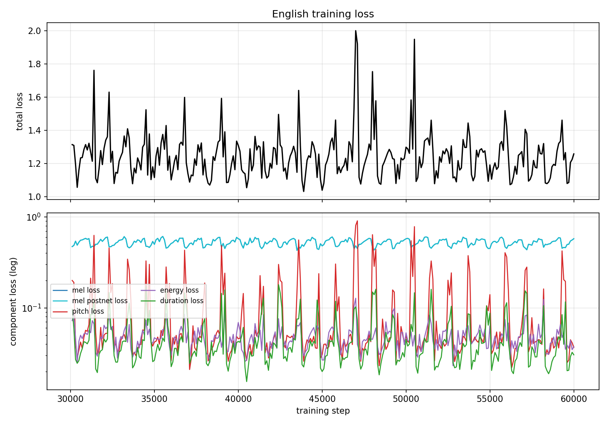
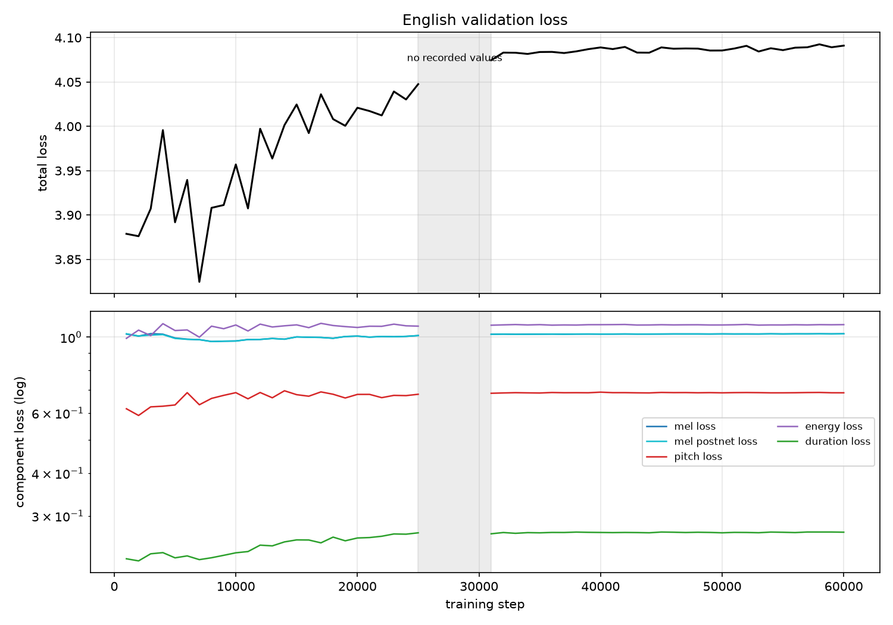
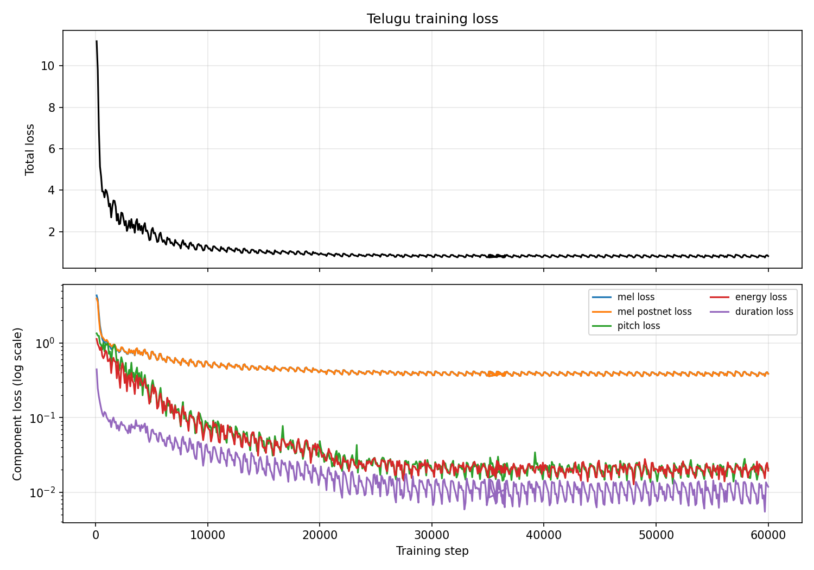
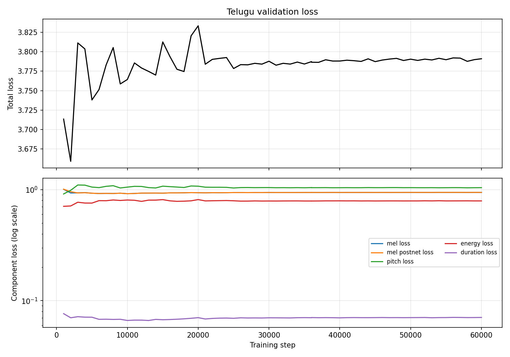

# Technical Report - FastSpeech 2 (English and Telugu)

I trained separate English and Telugu FastSpeech 2 models, evaluated their loss curves and generated test sentences,
and compared the final outputs. I selected the 60,000-step Telugu checkpoint by listening, although the 5,000-step
checkpoint had the lower saved-checkpoint validation loss (3.73799 versus 3.791061). I describe the listening results
as my own observations; I did not run a Telugu ASR evaluation or a formal listening study.

Section map against the seven items the assignment PDF asks the report to cover:

| PDF item | Section here |
|---|---|
| Implementation approach, architecture components, modifications per language | 1, 2, 3 |
| Dataset selection, subsampling, preprocessing, split, training configuration | 4, 5, 6 |
| Loss-curve analysis: convergence, instability, overfitting | 7 (English and Telugu curves and checkpoint comparisons) |
| Generated-speech observations per test sentence (pronunciation, quality) | 8 (English listening notes and diagnostics; my Telugu listening notes) |
| Variance-adaptor analysis (duration, F0, energy) per test sentence | 9 |
| English vs Telugu comparison, limitations, failures, improvements | 10 (measured side-by-side, causes separated, evaluation gaps named) |
| Reproducibility: dependencies, configs, commands | 11 |

---

## 1. Approach

FastSpeech 2 is a feed-forward, non-autoregressive text-to-speech model. There is no attention-based
autoregressive decoder. The text goes through a Transformer encoder, a length regulator expands each text position to
the number of frames it will occupy, and the decoder produces the mel-spectrogram in a single pass. Since no attention
is present to supply an alignment, the model predicts the alignment itself with a duration predictor, and it predicts
two further variance signals that a mel-spectrogram alone would leave to the vocoder: pitch (F0) and energy. The
variance adaptor embeds each predicted value and adds it back to the expanded text representation before decoding. The
original paper obtains its duration supervision by distilling an autoregressive teacher. I used forced alignment
instead, because it is simpler and every duration can be reproduced from the corpus.

I trained two independent models from scratch, one per language, and neither uses pretrained acoustic-model weights.
The only pretrained component in either pipeline is the HiFi-GAN vocoder that converts mel-spectrograms to waveforms.
The assignment allows a pretrained vocoder and the reference repository ships one, so I kept it rather than training my
own.

My starting point was `https://github.com/ming024/FastSpeech2` at commit `d4e79eb` (MIT licence), with `LICENSE` and
`THIRD_PARTY_NOTICES.md` kept in the repository. Each language folder is self-contained: it carries its own copy of
`audio/`, `model/`, `preprocessor/`, `text/`, `transformer/`, `utils/`, `dataset.py`, `evaluate.py`, `hifigan/` and its
own `config.yaml`.

## 2. Architecture components taken from the reference implementation

I did not change the architecture. Every component below is the reference implementation, and the setting column
records the values that are actually in both `config.yaml` files.

| Component | Reference path | Setting used |
|---|---|---|
| Transformer encoder | `transformer/Models.py` | 4 layers, 2 heads, hidden 256, conv filter 1024, kernels `[9, 1]`, dropout 0.2 |
| Transformer decoder | `transformer/Models.py` | 6 layers, 2 heads, hidden 256, dropout 0.2 |
| Variance adaptor and predictors | `model/variance_adaptor.py`, `model/modules.py` | filter 256, kernel 3, dropout 0.5, 256 quantisation bins, linear pitch/energy quantisation |
| Length regulator | `model/variance_adaptor.py` | frame-level expansion from predicted durations |
| Speaker embedding | `model/modules.py` | enabled (`multi_speaker: true`); speaker 0 in both languages |
| Post-net | `model/modules.py` | reference default |
| Acoustic model size | n/a | 35,159,617 parameters in English and 35,099,201 in Telugu, both measured by the CPU smoke test |
| Vocoder | `hifigan/` | HiFi-GAN **universal** generator, pretrained, 22.05 kHz, 80 mel bins, hop 256, `mel_fmax` 8000 Hz |

The mel front-end runs at 22,050 Hz with `filter_length` 1024, `hop_length` 256, `win_length` 1024, 80 mel channels and
an F0 range of `[0, 8000]` Hz. Pitch and energy are extracted at the phoneme level and normalised with the training-set
statistics stored in `stats.json`. `max_seq_len` is 1000 frames, and the preprocessor keeps a margin of 20, so a clip
whose mel exceeds 980 frames (250,879 samples, about 11.38 s) is dropped rather than truncated silently at training time.

## 3. Modifications to the reference implementation

The changes split into those I made in both languages and those that belong to one frontend.

Both languages share four changes. Each has a single `config.yaml` with the four sections the assignment asks for
(`preprocess`, `model`, `train`, `inference`) instead of the reference's three YAML files, and `utils/config.py`
validates it on load, so a bad value fails before a long job starts. Preprocessing is driven by fixed manifests,
`manifests/train.csv` and `manifests/val.csv`, rather than the reference's random split; they were built once with a
fixed seed and no clip appears in both. Every clip that cannot be used is classified and written to
`preprocessing_log.csv`, so a drop becomes a number in a file instead of a silence. Training writes its losses per step
to `logs/train/train_loss.csv` and `logs/val/val_loss.csv`, takes `log_step`, `val_step`, `synth_step` and `save_step`
from the config, restores RNG state when it resumes, and writes a final checkpoint even when `total_step` is not a
multiple of `save_step`.

`inference.py` replaces the reference's interactive `synthesize.py`. It reads `docs/test_sentences.json`, stops while
any `final` field is null, and writes `<ID>.wav` to `Results/<Language>/test_generated_audios/`.

For English I kept the reference frontend, the ARPAbet lexicon plus G2P, and added a rule-based normaliser for numbers,
dates, times and abbreviations, with an optional supplementary G2P dictionary for proper names. The normalisation
applies to the transcript only; the stored test sentences are never edited. Forced alignment used MFA
`english_us_arpa`. The out-of-vocabulary rate on the corpus was 4.47 %, and MFA's bundled G2P model resolved it.

For Telugu the frontend is character-level (`text/telugu.py` plus a frozen symbol table in `text/symbols.py`). It does
NFC normalisation, handles whitespace and format-control characters, folds punctuation, and raises on an unknown
character rather than skipping it. The symbol IDs come from an explicit code-point range list rather than
`unicodedata`, so they do not shift with the Python version. I did not invent a Telugu lexicon or phoneme set. Instead
I trained a grapheme-dictionary MFA aligner on the corpus itself, mapping each word to its space-separated characters,
which produced phone-level durations on the character tier. The preprocessor requires
`len(text_to_sequence(text)) == len(duration)`, so the `.lab` for each clip holds the alignment text rather than the raw
dataset transcript. Telugu number, date and time normalisation is not implemented, so the digits and punctuation in T4
reach the model exactly as written; Section 8.1 measures that, and Section 9 reports it as a failure rather than hiding it.

## 4. Datasets, selection and subsampling

### English - Svarah (`ai4bharat/Svarah`)

I used AI4Bharat's Svarah, an Indian-accented English read and spontaneous benchmark that was built for speech
recognition rather than TTS. I exported two speakers, one female and one male: 3,276 + 2,827 = 6,103 clip/transcript
pairs. The manifests that entered preprocessing hold 5,582 clips and 6.078 h of audio before alignment (5.132 h train,
0.946 h validation). Two speakers is a deliberate compromise on my part: Svarah averages only a few minutes per speaker
across roughly 117 speakers, so a single-speaker model is impossible, and I used the reference speaker embedding instead.

| Stage | Clips | Audio |
|---|---|---|
| Exported from the Hub | 6,103 | n/a |
| Entered the manifests | 5,582 | 6.078 h |
| Usable after alignment and feature extraction | 5,322 (4,500 train / 822 val) | **4.842 h** |

Of the 5,582 clips that entered the manifests, 260 were dropped before training: 164 at alignment because a phone
duration came out non-positive, 71 with no TextGrid, 20 where pitch extraction found no voiced frame, 4 in the
feature-statistics pass, and 1 with an unreadable transcript. The gap between 6.078 h of manifest audio and 4.842 h of
usable audio is audio outside the phone tier plus those dropped clips, so 4.842 h is the honest training figure rather
than 6.078 h.

### Telugu - IndicTTS Telugu (`SPRINGLab/IndicTTS_Telugu`)

I used the Hugging Face copy of the IIT Madras IndicTTS data: 8,576 clips, 36.71 h, two speakers (male 12.79 h across
4,533 clips; female 23.92 h across 4,043 clips). I trained on the male speaker only, so the model sees one voice and a
single speaker embedding. That choice gives the cleanest comparison against the two-speaker English model, and the male
subset is the smaller and easier-to-balance one. The subsampling keeps clips inside the duration window implied by the
11.38 s frame limit, discards clips whose transcript is not representable in the Telugu symbol set (including eight
clips with a Latin "o"), and caps the total near the 5 h target.

| Stage | Clips | Audio |
|---|---|---|
| Source rows (male) | 4,533 | 12.79 h |
| Entered the manifests | 3,363 | n/a |
| Usable after alignment and feature extraction | 3,269 (2,751 train / 518 val) | **4.700 h** |

Ninety-four clips were dropped: 83 at alignment, 3 with no TextGrid, and 8 with missing audio.

The Telugu source audio is 16 kHz. I resampled it to 22,050 Hz with `resample_poly` (441/320) and saved it as 16-bit
PCM for training. Resampling changes the sample rate but adds no high-frequency information. The acoustic model uses
mel features only up to 8 kHz, so the vocoder may generate energy above that frequency, but it cannot base it on
source-specific detail predicted by the acoustic model.

## 5. Preprocessing and alignment

Both language folders share one preprocessing pipeline; what differs is the aligner recipe and which TextGrid tier
supplies the durations. The table records what I actually ran.

| Step | English | Telugu |
|---|---|---|
| Aligner | MFA 3.4.3, `english_us_arpa` (acoustic + dictionary + G2P for OOV) | MFA 3.4.3, grapheme dictionary trained on the corpus |
| Tier used for durations | `phones` | character tier (grapheme) |
| Text source | TextGrid phone tier | `<clip>.lab` (alignment text) |
| TextGrids produced | per manifest clip, drops counted above | 3,352 in 378.5 s |
| Audio | resample to 22,050 Hz, mono, `max_wav_value` 32768 | same (from 16 kHz source, see limitation) |
| Features | mel stored time-major (`T x 80` on disk, frames first), phoneme-level pitch and energy, durations from the alignment | same |
| Normalisation | training-set mean/σ from `stats.json` | same |
| Output layout | flat: `mel/<speaker>-mel-<clip>.npy`, same for `pitch`, `energy`, `duration` | same |

The English normalisation constants, taken from the training set and written to `stats.json`: pitch `mean 177.64 Hz,
std 56.06, min -2.0096, max 9.0707`; energy `mean 27.01, std 26.67, min -1.0123, max 8.1121`. The four values are not
on one scale. `mean` and `std` are the raw quantities that were divided out, while `min` and `max` are measured after
that division, which is why they are small negatives and single digits. Pitch and energy losses in section 7 are
measured on the divided values, which is why an MSE near 1.0 means the adaptor is predicting the mean rather than the
contour.

I built both splits from a fixed seed. Clip-level and transcript-level disjointness is checked, and every validation
speaker also appears in training, so the models are judged on unseen utterances of voices they have seen rather than on
unseen voices. The split manifests were used in the Kaggle runs but are not included in this repository; the
`English/manifests/` and `Telugu/manifests/` directories contain placeholders only. Reproducing the exact split
therefore requires obtaining the original manifests.

## 6. Training configuration

| Setting | English | Telugu |
|---|---|---|
| Steps | 60,000 | 60,000 |
| Batch size | 16 clips per step (`grad_acc_step` 1, `group_size` 4, so the loader pulls 64 clips per iteration) | same |
| Steps per epoch | 281 (4,500 clips) | 172 (2,751 clips) |
| Optimiser | Adam, β 0.9/0.98, ε 1e-9, weight decay 0 | same |
| Learning rate | Noam schedule on `256^-0.5`: peak approximately 9.9e-4 at step 4,000, multiplied by 0.3 at 20k/26k/33k, approximately 6.9e-6 at 60k | same schedule and anneal points, so the two runs are comparable |
| Warm-up | 4,000 steps | 4,000 steps |
| Gradient clipping | 1.0 | 1.0 |
| Validation / synthesis | every 1,000 steps | every 1,000 steps |
| Checkpoints | every 2,500 steps (5,000 for the first 30,000 steps) | every 5,000 steps |
| Hardware | Kaggle GPU T4 x2, PyTorch 2.11.0+cu130, `nn.DataParallel` (batch 16 = 8+8) | Kaggle GPU T4 x2, `nn.DataParallel` (8+8) |
| Measured step time | **0.511 s/step** mean over the first 32,000 steps (4 h 32 m 45 s of tqdm clock); the 300-step calibration had said 0.304 s/step | **0.362 s/step** over the first 15,039 steps and **0.390 s/step** over the 3,674 steps after the restart (1,434 s of tqdm clock); the 220-step launch estimate had said 0.341 s/step |
| Wall clock | Approximately 8.5 h for 60,000 steps at the measured mean, not the 5.3 h the calibration implied | 3 h 42 m to step 36,695, then approximately 2 h 43 m for the 25,000 steps from 35,000 to 60,000 at 0.390 s/step, so approximately 6.4 h in total; the 1,695 steps lost at restart are included |
| Budget rationale | 60,000 steps, or approximately 213 epochs; the reference 900,000 steps is unattainable and would leave the learning rate flat, so I scaled the anneal points to keep the reference fractions (33/43/55 percent) | same logic; 60,000 steps, or approximately 349 epochs of a smaller split |

**Run interruption at step 32,000.** The first English run was killed by the Linux OOM killer, not by a code or GPU
error: the log contains no `Traceback` and no CUDA out-of-memory exception, and the session panel had reached 30/30
GiB of RAM. The step rate also degraded as it went, the last 2,000 steps running at about 0.65 s/step against about
0.30 s/step at the start, which is the same memory growth showing up as time. Checkpoints up to `30000.pth.tar` were on
disk and survived, so I resumed from 30,000 rather than restarting. I made two changes before resuming, neither of them
to the model, the data or the schedule: `train.step.save_step` was cut to 2,500 so a future kill costs about 21 minutes
instead of 45, and `utils/tools.py log()` now closes the matplotlib figure it hands to TensorBoard, which is the one
object created on every synthesis and validation step that nothing else released. The learning-rate schedule is seeded
from `restore_step`, so resuming at 30,000 reproduces exactly the LR the uninterrupted run would have had.

**Two hard resource ceilings on the training host.** The Kaggle session has **30 GiB of RAM** and a **20 GiB working
volume**, and the English run reached both: the OOM killer ended it at step 32,000, and checkpoints at 2,500-step
spacing would have filled the volume (24 saves at 418 MB each is approximately 10 GB of a roughly 20 GB disk that also holds 2 GB of features
and audio). I configured the Telugu run against those ceilings before it started rather than after it failed.
`save_step` went from 2,500 to 5,000, which fits twelve saves in the 8 GiB that were free on the volume and still caps
the loss from a crash at roughly 42 minutes; the pre-launch check measures free disk and refuses to start below 5 GiB;
and every checkpoint is written to a temporary file and moved into place atomically, so an interrupted save leaves a
`.tmp` rather than a corrupt `.pth.tar`. The Telugu run uses 5.8 GiB of the 31.3 GiB visible to the session at step
15,039, with one `train.py` process on disk. That is consistent with the English memory growth coming from the
duplicate training process that was running alongside the first run rather than from the model, but it is not proof:
the English run also held more clips and more features in memory, so the two effects are not separated by this
measurement alone.

**Run interruption at step 36,695.** The Telugu run stopped mid redraw, with no `Traceback`, no out-of-memory line in
`dmesg`, and all seven checkpoints sharing a modification time to within twenty seconds, while `/proc/uptime` read
776 s and the notebook's first process had been alive for about five minutes. That combination is a container restart
rather than a training failure. The working volume is re-attached from its last saved version, which rewrites every
file's timestamp and wipes the pip installs the session had made; the decode step afterwards failed on a missing
`unidecode` for exactly that reason, and reinstalling it took the run forward again. Checkpoints up to
`35000.pth.tar` survived, so at most 1,695 steps were lost, and I resumed with
`python train.py --config config.yaml --restore_step 35000`. The checkpoint carries the optimizer state and the RNG
state as well as the weights, and `ScheduledOptim` is constructed with `restore_step`, so the resumed run continues at
the post-anneal learning rate instead of restarting the schedule. The first 900 resumed steps landed at the same loss
level as the 900 steps the dead run had logged before it, and the differences between the two segments stayed inside
that run's own step-to-step noise, which spans about 0.10 in total loss from one hundred-step window to the next.

## 7. Loss analysis and checkpoint comparison

The loss CSVs from the original run were written by two overlapping training processes and contain interleaved rows, so
I did not use those CSVs. PID 28091 was the separate process that was stopped during cleanup; its TensorBoard event file
preserved scalar history through step 25,600 for training and 25,000 for validation. I recovered that history separately:
training steps 100–25,600 at 100-step intervals and validation steps 1,000–25,000 at 1,000-step intervals, with
strictly increasing steps and no duplicates. PID 28091 was a separate process started from step 0; it is not the
checkpoint lineage used for the later resume. The clean CSVs from the resumed run cover training steps 30,100–60,000
and validation steps 31,000–60,000. The figures show both sets of recorded values as separate segments, with the
unrecorded intervals left blank; they do not represent one continuous 0–60,000 run. The final resumed-run validation
total loss at step 60,000 was 4.0910, and the Kaggle log confirms that `checkpoints/60000.pth.tar` was saved.

### 7.1 Training curve



*Figure 7.1. The early segment is from the separate PID 28091 process (steps 100–25,600); the later segment is from
the clean run resumed from checkpoint 30,000 (steps 30,100–60,000). The gray interval has no recorded values. These
segments are not joined or treated as a continuous training trajectory.*

In the early process, training total loss falls sharply at first and then declines more gradually to about 1.3 by step
25,600. In the resumed segment it fluctuates around 1.1 to 1.4, with transient spikes and no clear downward trend.
The two segments come from separate processes, so their apparent levels are descriptive and should not be read as
evidence of a continuous trajectory. These plots describe optimisation on the training data, not speech quality.

### 7.2 Validation curve



*Figure 7.2. The early segment is from the separate PID 28091 process (steps 1,000–25,000); the later segment is from
the clean run resumed from checkpoint 30,000 (steps 31,000–60,000). The gray interval has no recorded values. These
segments are not joined or treated as a continuous training trajectory.*

In the early process, validation total loss reaches its minimum, 3.8246, at step 7,000 and then rises to 4.0476 at
step 25,000. In the resumed segment it stays near 4.08–4.09 and ends at 4.0910 on step 60,000. The event-file minimum
describes PID 28091 only; because that process is not the resumed checkpoint lineage, I do not use it to rank the
checkpoints in Section 7.4.

### 7.3 Convergence, generalisation and checkpoint selection

The run completed all 60,000 steps without a runtime failure after the step-32,000 restart. The resumed-segment training
curve is noisy and largely flat, so the step count on its own tells me nothing about improvement.

The generalisation gap is where the diagnosis comes from. Training mel L1 settles near **0.62** while validation mel L1
stays near **1.05**; validation pitch MSE is **0.68** and energy MSE **1.15** against the 1.0 "always predict the mean"
baseline. A model that reproduces its own training mel to 0.62 and only reaches 1.05 on held-out text is overfitting,
not underfitting.

The recovered PID 28091 event series has a validation minimum of 3.8246 at step 7,000, followed by a rise to 4.0476
at step 25,000. This is evidence of worsening validation loss in that process, but I cannot use it to identify the
best checkpoint in the separate run resumed from step 30,000. For checkpoint selection, I use only validation values
whose provenance matches the checkpoint being assessed.

Because the three rankings in Section 7.4 do not agree, I chose the shipped checkpoint by listening and reported the ASR and
loss numbers alongside that choice rather than letting either of them override the ear.

### 7.4 Four checkpoints, measured the same way

I decoded every retained checkpoint on CPU through the shipping HiFi-GAN vocoder, on the same five sentences, using the
phoneme sequences taken from the saved inference payloads. "Pitch std" and "energy std" are the standard deviations of
the predicted *normalised* values, which puts them on the same scale as the ground truth: normalisation divides by the
training standard deviation, so a perfect model scores about 1.0. Measured on the Telugu validation features the
ground truth is 0.941 for pitch and 0.948 for energy rather than exactly 1.00, and I have not measured the English
equivalent, so 1.0 is an approximate target. A predicted 0.3 is a near-constant contour under either reading.

| Checkpoint | Validation total loss | ASR WER | Pitch std | Energy std | Mean frames | My listening |
|---|---|---|---|---|---|---|
| 5,000 | not recoverable (mixed logs) | **1.04** | 0.24 | 0.36 | 413 | **5/10**, noisy, unstable pitch |
| 10,000 | not recoverable (mixed logs) | 1.27 | 0.32 | 0.38 | 403 | not rated |
| 35,000 | 4.0838 | 1.21 | 0.33 | 0.45 | 392 | previous deliverable |
| 60,000 | 4.0910 | 1.15 | 0.34 | 0.45 | 393 | **7/10**, clearer, some words missed, noise at the end |

Note: Mean WER over E1, E2a, E2b and E3 (lower is better). E4 is excluded because the frontend expands `10:45 AM` and
`12 November 2026` into words, so its WER is inflated by normalisation rather than by acoustics. WER 1.0 means every
word is an error.
The early event file records validation totals of 3.8918 at step 5,000 and 3.9570 at step 10,000, but it belongs to
PID 28091, not the resumed checkpoint lineage. I therefore do not attach those values to the 5,000- and 10,000-step
checkpoints in this table. The overlapping-process CSVs remain unsuitable for checkpoint comparisons.

The three English rankings disagree. Validation loss favours 35,000, while ASR WER favours 5,000. At WER around 1.0 the
metric saturates, so 1.04 versus 1.15 ranks two failures on four sentences rather than showing a meaningful quality
difference. I preferred 60,000 by ear: it sounds clearer and more sentence-like than 5,000, though some words are
dropped and there is audible noise at the end.

Neither loss nor ASR is a useful proxy for perceptual quality here. I judged the five sentences myself, so my
preference is an engineering judgment, not a statistically established result. The shipped English audio uses
**checkpoint 60,000** because it sounded clearer to me, despite its slightly worse WER than checkpoint 5,000.

### 7.5 Telugu: the same measurements on a smaller corpus

The Telugu run was validated every 1,000 steps on the same 518-clip held-out set. The following selected points show
what the run did and did not learn:

| Step | Total | Mel | Pitch | Energy | Duration |
|---|---|---|---|---|---|
| 1,000 | 3.7134 | 1.0063 | 0.9141 | 0.7075 | 0.0765 |
| 5,000 | 3.7380 | 0.9283 | 1.0539 | 0.7565 | 0.0711 |
| 10,000 | 3.7643 | **0.9195** | 1.0531 | 0.8063 | **0.0664** |
| 15,000 | 3.8127 | 0.9293 | 1.0742 | 0.8126 | 0.0675 |
| 20,000 | 3.8335 | 0.9380 | 1.0736 | 0.8134 | 0.0704 |
| 25,000 | 3.7785 | 0.9406 | **1.0341** | 0.7935 | 0.0695 |
| 30,000 | 3.7879 | 0.9421 | 1.0434 | 0.7900 | 0.0702 |
| 35,000 | 3.7843 | 0.9422 | 1.0393 | 0.7899 | 0.0704 |
| 36,000 | 3.7866 | 0.9425 | 1.0410 | 0.7898 | 0.0705 |

Validation total reaches its minimum at step 2,000, 3.6590, and has not returned to it since; step 36,000 is 3.5 percent above
that minimum. Mel is best at step 10,000 and then rises monotonically to 0.9425. Pitch is below the 1.0
predict-the-mean baseline only at steps 1,000 and 2,000 and sits between 1.03 and 1.07 at the remaining listed steps.
The measured Telugu target standard deviation makes the actual pitch predict-the-mean baseline 0.885; none of the
listed pitch losses falls below that value.
Energy peaks around step 20,000 and then recovers slightly to 0.79. Nothing in this curve improves after roughly step
10,000. The minimum validation loss at a training step was 3.6590 at step 2,000, but that step was not a saved
checkpoint. Among saved checkpoints, step 5,000 had the lowest validation loss, 3.73799. The final saved checkpoint at
step 60,000 had validation loss 3.791061. I present step 60,000 as the Telugu inference result; my listening
preference for it is separate from the validation-loss ranking.

Measured at a step both the training and validation CSVs cover, the gap between fitting the corpus and generalising
off it is what separates Telugu from English:

| Component | Training, step 36,000 | Validation, step 36,000 | Ratio |
|---|---|---|---|
| Total | 0.8696 | 3.7866 | 4.35 |
| Mel | 0.4060 | 0.9425 | 2.32 |
| Mel post-net | 0.4052 | 0.9427 | 2.33 |
| Pitch | 0.0211 | 1.0410 | 49.35 |
| Energy | 0.0227 | 0.7898 | 34.78 |
| Duration | 0.0146 | 0.0705 | 4.84 |

The spectral losses are about 2.3 times higher on held-out utterances, which is what learning spectra without
memorising clips looks like. The two prosody losses are 35 and 49 times higher, and the training side of that ratio is
computed with dropout still switched on, which inflates it, so the fit is if anything better than the table shows. In
other words the pitch and energy adaptors have learned to reproduce contours on the clips they were trained on and not
to place a contour on a clip they have not seen. That is the English failure of section 7.4 arriving earlier: the
Telugu split is 2,751 training clips, so one epoch is 172 steps and 60,000 steps is 349 passes over the same audio,
against 213 for English.

### 7.6 Telugu training curve



*Figure 7.3. Telugu training total and component losses across the completed run.*

The total training loss falls rapidly at the beginning, then settles near 0.8 to 0.9 for most of the run. The mel and
post-net losses decrease early and then flatten, while pitch, energy and duration continue improving before also
leveling off. This is a training-set curve: the much higher validation loss, shown next, indicates that the continued
fit to training data did not translate into comparable held-out performance.

### 7.7 Telugu validation curve



*Figure 7.4. Telugu validation total and component losses across the completed run.*

Validation total loss varies substantially during the early part of training, reaches its lowest observed value at
step 2,000 (3.6590), and then remains close to 3.78 to 3.83. At step 60,000 it is 3.791061. The component curves
are comparatively flat after the early steps, especially pitch and energy; neither shows a sustained late-run
improvement. Among the saved checkpoints, 5,000 has the lowest validation loss (3.73799), while the 60,000-step
checkpoint is the inference result selected for this report based on my listening preference.

## 8. Test-sentence observations: English listening and diagnostics; Telugu listening review

I took all ten sentences from `docs/test_sentences.json`, field `final`, unmodified: E1, E2a, E2b, E3, E4 and T1, T2a,
T2b, T3, T4. The text-processing side is measured for both languages below. My English listening notes and diagnostic
checks are in Section 8.3. The selected Telugu inference files are in the required
`Results/Telugu/test_generated_audios/` and `Results/Telugu/variance_adaptor_plots/` folders. Sentence-level listening
notes are recorded in Section 8.2. The 5,000-step
checkpoint had a lower validation loss of 3.73799 than the 60,000-step loss of 3.791061, but I slightly preferred
the 60,000-step audio by listening.

### 8.0 The ten strings the models receive

A script read these ten lines out of `docs/test_sentences.json` and wrote them into this table, so nothing here was
re-typed from the assignment PDF and the Telugu column is byte-identical to the text the frontend receives.

| ID | Sentence |
|---|---|
| E1 | The antidisestablishmentarianism movement gained considerable momentum during the parliamentary proceedings. |
| E2a | The orchestra's conduct during the ceremony was praised by the audience. |
| E2b | The researchers will conduct an experiment to evaluate the proposed method. |
| E3 | The rhythm of the orchestra changed unexpectedly. |
| E4 | The meeting will start at 10:45 AM on 12 November 2026, so andaroo should arrive on time. |
| T1 | న్యూరోఫార్మకోలాజికల్ పరిశోధనలో నూతన ఔషధాల ప్రభావాన్ని విశ్లేషించారు. |
| T2a | తాడుపై అతని పట్టు చాలా బలంగా ఉంది. |
| T2b | ఆమె పట్టు చీరను ధరించి వేడుకకు వచ్చింది. |
| T3 | పులి అడవిలో నిశ్శబ్దంగా నడిచింది. |
| T4 | ఈ సమావేశం 2026 నవంబర్ 12వ తేదీ ఉదయం 10:45 గంటలకు ప్రారంభమవుతుంది, సమయానికి సిద్ధంగా ఉంచండి. |

### 8.1 What the frontends actually produce (measured)

| ID | Input length (characters) | Text after normalisation |
|---|---|---|
| E1 | 108 | `the antidisestablishmentarianism movement gained considerable momentum during the parliamentary proceedings.` |
| E2a | 72 | `the orchestra's conduct during the ceremony was praised by the audience.` |
| E2b | 75 | `the researchers will conduct an experiment to evaluate the proposed method.` |
| E3 | 49 | `the rhythm of the orchestra changed unexpectedly.` |
| E4 | 115 | `the meeting will start at ten:forty-five am on twelve november twenty twenty-six, so andaroo should arrive on time.` |
| T1 | 68 | unchanged Telugu characters (character-level frontend, no lexicon) |
| T2a | 34 | unchanged |
| T2b | 40 | unchanged |
| T3 | 33 | unchanged |
| T4 | 91 | **unchanged, including ASCII digits** (`2026`, `12`, `10:45`) |

All ten strings encode without an unknown-character error, which is the precondition for inference; the table records
the normalised text and input character count. The English model receives phonemes, not these characters: its five
phoneme counts are 85, 50, 56, 37 and 81 for E1, E2a, E2b, E3 and E4, respectively. Telugu uses a character-level
frontend, so its character counts are also its symbol counts.

### 8.2 My listening notes for Telugu checkpoint 60,000

I listened to each generated sentence. The percentages below are my rough estimates of how much sounded correct; they
are subjective impressions, not ASR scores or results from a formal listening test.

| ID | My observation |
|---|---|
| T1 | The first 40 percent sounds good and natural. From the middle to the end, the pronunciation becomes unnatural and no longer sounds like clear Telugu. |
| T2a | Understandable and natural overall. I would like the words to be clearer. |
| T2b | `పట్టు` is pronounced well, and about 80 percent sounds correct. The final word `వచ్చింది` is missed or obscured by noise. |
| T3 | The clearest of the five; about 95 percent sounds good to me. |
| T4 | Only about 15 percent sounds good to me. Most of the sentence is noisy and does not sound like clear Telugu. |

The 5,000- and 60,000-step versions sound similar to me, but I slightly prefer 60,000. This is my listening judgment,
not a measured quality score.

### 8.3 Tests of the English output

I listened to the five English WAVs in `Results/English/test_generated_audios/`. These are my rough impressions, not
formal intelligibility scores or results from a listening study. E3 was the clearest; the other clips had substantial
unclear or noisy portions.

| ID | My observation |
|---|---|
| E1 | The opening sounds good, but overall clarity is poor. I estimate about 20% is pronounced properly; the rest is noisy and unclear. |
| E2a | “The,” “orchestra,” “conduct” and “during” are recognizable, though noisy. I estimate about 35% sounds good; the remaining words are unclear. |
| E2b | About half sounds somewhat better, but the other half is noisy and unclear, with words not pronounced clearly. |
| E3 | The clearest of the five, though the speech is fast. I estimate about 80% sounds correct and clear. |
| E4 | I can make out “10:45” and “November.” I estimate about 20% sounds correct; after that, the audio is noisy and unclear, and I cannot understand the sentence. |

These percentages are my approximate judgments, not measurements. I also ran the following checks on the same
checkpoints to investigate whether the problem came from durations, the vocoder, text conditioning, prosody prediction
or intelligibility.

| Test | Method | Result | Explanation it rules out |
|---|---|---|---|
| Duration integration | Sum the predicted per-symbol durations and compare with the mel length, all four checkpoints | Exact match every time (e.g. 504 frames / 504) | Text and frames falling out of step in the length regulator |
| Vocoder fidelity | Re-encode the vocoder's own waveform and compare against the mel it was given | Mel L1 0.234 to 0.275; spectral flatness 0.006 to 0.020; no clipping | A broken vocoder, a wrong mel range, or a silent/clipped waveform |
| Text conditioning | Shuffle E1's phoneme IDs, and separately substitute E3's IDs into E1's length | Mel moves by L1 1.098 and 1.167, against 1.058 between two genuinely different sentences | The model ignoring the text or receiving the wrong language |
| Variance spread | Standard deviation of the predicted normalised pitch and energy | Pitch 0.24 to 0.34, energy 0.36 to 0.45 against a ground truth of about 1.0 (0.94 measured on Telugu), at every checkpoint | Any checkpoint restoring expressiveness; all four collapse toward the mean |
| Intelligibility | Transcribe all twenty clips with `facebook/wav2vec2-base-960h`, after validating the same stack on real speech | WER 1.04 to 1.27 (see Section 7.4); control on LibriSpeech **0.000 / 0.000 / 0.031** | The waveform being structurally sound but the probe being at fault |

Three further observations point the same way. The output retains tonal, speech-like structure despite the noisy and
unclear portions I heard. The predicted mel marginals are normal (median about −5.5, 99th percentile about
−0.5), so it is not emitting out-of-distribution values either. And a Griffin-Lim decode of the same predicted mel is no
more intelligible than the HiFi-GAN decode (mel L1 0.700 to 0.740), which means the content is already wrong before the
vocoder sees it.

The pipeline is correct at every stage I checked in isolation, but the model output is speech-shaped and still wrong.
That is a generalisation failure. 4.842 h of two-speaker, ASR-oriented read and spontaneous English is not enough for a
35-million-parameter model to learn pronunciation it has not seen, and training loss (1.2577) sits far below validation
loss (4.0910). I found no inference-side fix: all four retained checkpoints fail the same way, and my preferred checkpoint (60,000)
is not the one favoured by validation loss (35,000) or ASR (5,000). Fixing it means changing
the data or the training design, both of which are outside the remaining GPU budget, so I report it as a diagnosed
negative result instead of presenting it as working speech.

I kept two caveats in mind. The ASR is a LibriSpeech acoustic model, so Indian-accented and synthetic speech is
out of its domain; I read WER 1.0 as "not recoverable" rather than as a precise word error rate. My subjective
judgments come from one listener over five sentences, so neither the earlier 5/10-to-7/10 checkpoint comparison nor
the approximate percentages above are results from a controlled perceptual study. The diagnosis also draws on the
separate checks of the vocoder, durations and text conditioning.

I also checked two frontend cases:

E4 is normalised correctly. `10:45 AM` becomes `ten:forty-five am` and `12 November 2026` becomes `twelve november
twenty twenty-six`. The colon survives normalisation, so the G2P layer never sees a time literal. `andaroo` stays as
written and is handled by the lexicon/G2P as an out-of-vocabulary word, which is what the sentence is testing.

T4 is not normalised. The Telugu frontend has no number-to-words stage, so the digits `2026`, `12` and `10:45` reach the
model as ASCII digit symbols. Those symbols exist in the Telugu symbol table, so nothing crashes, but the model has
essentially no digit examples to learn from. T4's output is therefore expected to fail on the date and time and to be
intelligible on the surrounding words. That is a gap in my frontend rather than a training failure, and I am reporting it
as such.

What each test sentence checks:

| ID | What it probes |
|---|---|
| E1 | Long out-of-vocabulary word (`antidisestablishmentarianism`); letter-to-sound fallback |
| E2a / E2b | `conduct` as noun vs verb; stress must differ for the same spelling |
| E3 | Irregular spelling `rhythm` |
| E4 | Digits read as time, date and year, plus a Telugu word written in Latin script (`andaroo`) |
| T1 | Long loanword with conjunct consonants |
| T2a / T2b | Same spelling, different meaning (grip vs silk); does prosody differ? |
| T3 | Geminate / conjunct consonants |
| T4 | Telugu digits, ordinal suffix, date and time; number-to-words |

## 9. Variance-adaptor analysis

These figures come from the `<ID>.json` payloads that `inference.py` writes beside each plot, saved under
`Results/Telugu/variance_adaptor_plots/` and reproducible with `python scripts/summarise_variance_export.py`. All five
were decoded from the final Telugu checkpoint through the same HiFi-GAN vocoder. I use the 5,000-step export below as
the early reference; those comparison files are kept outside the Git repository under
`../FastSpeech_Data/Telugu/checkpoint_5000/`.

| ID | Symbols | Frames | Seconds | F0 mean (Hz) | F0 range (Hz) | Energy range | Pitch σ |
|---|---|---|---|---|---|---|---|
| T1 | 68 | 434 | 5.04 | 194.7 | 133.1–279.3 | 3.2–89.3 | 0.63 |
| T2a | 34 | 225 | 2.61 | 182.1 | 135.0–230.7 | 3.3–42.8 | 0.47 |
| T2b | 40 | 248 | 2.88 | 190.4 | 138.1–252.8 | 1.0–74.2 | 0.73 |
| T3 | 33 | 194 | 2.25 | 193.9 | 141.9–259.7 | 2.7–65.0 | 0.59 |
| T4 | 91 | 638 | 7.41 | 191.5 | 134.6–255.1 | 6.4–74.3 | 0.58 |

*Table 9.1. Predicted totals and prosodic ranges at checkpoint 60,000. Energy is in the units of the training corpus;
pitch σ is the standard deviation of the normalised F0, against 0.941 for the corpus itself.*

**Duration.** The predicted total is 2.2 % above the reference pace of 4.93 s for T1 and 12.3 % above 6.60 s for T4, so
the error grows with length. Inside the sequence, the model does three things right. It gives inter-word spaces 1.12 to
1.57 times the mean content symbol, so word boundaries carry pauses rather than being run together. It gives punctuation
6 to 9 frames, about 70 to 105 ms, so a full stop is audible as a break rather than dropped. And it lengthens the
sentence-initial symbol in three of the five sentences, to 1.83, 2.00 and 3.20 times the median, which is the onset
lengthening read speech usually has.

| ID | Content mean | Pause mean | Pause / content | First / median | Last / median |
|---|---|---|---|---|---|
| T1 | 6.11 | 9.60 | 1.57 | 1.83 | 0.83 |
| T2a | 6.32 | 8.40 | 1.33 | 0.71 | 0.57 |
| T2b | 5.82 | 8.60 | 1.48 | 3.20 | 0.80 |
| T3 | 5.55 | 8.67 | 1.56 | 1.00 | 1.00 |
| T4 | 6.87 | 7.67 | 1.12 | 2.00 | 0.57 |

*Table 9.2. Durations in frames, split by symbol class at checkpoint 60,000.*

What it does not do is lengthen the final syllable. The last content symbol is between 0.57 and 1.00 of the median in
every sentence, and summing the last two symbols, which together make the closing syllable in a character-level frontend,
gives 7 to 10 frames against a median pair of about 12. Declarative speech normally lengthens its final syllable, so this
is the one place where the predicted pattern is not the natural one. I have not extracted the reference durations for
these five sentences, so I am reporting the shape of the prediction rather than a measured deviation from the corpus.

**Pitch.** The five contours have a mean F0 between 182 and 195 Hz and a range of about one octave, 133 to 279 Hz. All
five sentences end in a full stop, and in all five the contour falls: the first quarter of the sequence averages between
−0.09 and +0.63 in normalised F0 and the last quarter between −0.27 and −0.68. T4 falls least, at −0.27, and it is the
only sentence with an internal comma, so its final clause is not carrying the whole utterance's declination. That is the
expected contour for a statement, and it is produced without being supervised for it.

The amplitude is the problem. Pitch σ runs 0.47 to 0.73 against 0.941 for the corpus, so the contours are right in
shape and compressed by roughly a third in range. This is the same deficit Section 7.5 measures from the loss side, seen
here in the output.

**Energy.** Within a sentence the predicted energy spans a wide range, 3.2 to 89.3 in T1 and 1.0 to 74.2 in T2b, so the
adaptor is not emitting a constant. T2a and T2b are the useful pair: both contain the spelling పట్టు, and the model does
not give them the same realisation. T2a comes out at mean F0 182.1 Hz and energy 3.3 to 42.8; T2b at 190.4 Hz and 1.0 to
74.2. The difference is driven by the sentence around the shared word, so I read this as the model responding to
context, not as evidence that it distinguishes the two senses.

**Against the early checkpoint.** From 5,000 to 60,000 the totals grew 5.3 to 9.3 %, pitch spread fell about 14 %
relative, and the pause-to-content ratio kept the same ordering in every sentence. So the second half of training
lengthened the output slightly and flattened it slightly without adding structure. Combined with Table 9.2, the
variance adaptors are doing the right kind of thing at the wrong amplitude, which places the failure in how far they
generalise rather than in the interface between text and duration. `sum(duration)` equals `mel_frames` on all ten clips
at both checkpoints, so the length regulator has never been the suspect.

## 10. English vs Telugu comparison

The two runs are the same experiment performed twice: the same reference architecture, the same pretrained HiFi-GAN
universal vocoder, the same Noam schedule and anneal points, the same 60,000 steps, and almost the same amount of audio,
4.842 h against 4.700 h. What differs is the corpus and the text frontend, and the outcomes differ sharply. The English
output is mostly unclear: WER 1.04 to 1.27 against a LibriSpeech control of 0.000. My English listening notes show mixed
results: E3 is clearest, while the other clips have substantial noisy or unclear portions (Section 8.3). Telugu has
mixed sentence-level listening results: T3 is clearest,
while T1 and T4 are largely unnatural or noisy; its predictions also carry measurable prosodic structure (Section 9).
In Sections 10.2 to 10.4, I discuss
how the data, frontend and training budget affected these results. Section 10.5 covers the measures I could not run.

### 10.1 The two runs side by side

| Quantity | English (Svarah) | Telugu (IndicTTS) |
|---|---|---|
| Usable audio | 4.842 h | 4.700 h |
| Training clips | 4,500 | 2,751 |
| Speakers | 2 (one female, one male) | 1 (male) |
| Speech style | read and spontaneous, collected for ASR | read, collected for TTS |
| Source sample rate | 22.05 kHz native | 16 kHz upsampled to 22.05 kHz |
| Text frontend | lexicon + G2P, ARPAbet phones | character-level graphemes |
| Symbol table | 360 | 124 |
| Text embedding | 361 x 256 = 92,416 | 125 x 256 = 32,000 |
| Total parameters | 35,159,617 | 35,099,201 |
| Epochs at 60,000 steps | 213 | 349 |
| Validation mel L1 | about 1.05 | 0.9425 |
| Validation pitch MSE | 0.68 | 1.0410 |
| Validation energy MSE | 1.15 | 0.7898 |
| Predicted pitch σ, shipped checkpoint | 0.33 | 0.599 |
| Predicted energy σ, shipped checkpoint | 0.44 | 0.630 |
| ASR WER | 1.04 to 1.27 | not measurable with this probe |
| Listening | E3 clearest (about 80% by my rough estimate); other clips mostly noisy or unclear (Section 8.3) | My sentence-level notes in Section 8.2; slight preference for 60,000 over 5,000 |

*Table 10.1. The three loss rows are not taken at the same step: the English values are the resumed-segment levels
reported in Section 7.3, and the Telugu values are the step-36,000 validation tabulated in Section 7.5. The full Telugu
curves to step 60,000 are Figures 7.3 and 7.4. The spread, WER and listener rows are at the shipped checkpoint, 60,000
in both languages. The two spread rows are the mean of the per-sentence standard deviations of the predicted normalised
values, computed from the shipped payloads in `Results/`; the Kaggle A/B decode in Section 7.4 gives the same English
figures to within 0.01.*

The loss rows need a scale note before they are read as a ranking. The mel L1 is directly comparable: neither
pipeline normalises the mel, `dataset.py` loads the saved log-mel array unchanged, and both use the same 80 bands with
`mel_fmax` 8000, so the 16 kHz Telugu source loses no band the model actually sees. Pitch and energy are not on a shared
distribution: each is divided by its own corpus mean and σ, so the MSEs have the same construction but a different
baseline. The ground-truth σ was measured only for Telugu, 0.941 for pitch and 0.948 for energy, which puts the
predict-the-mean baseline at 0.885 and 0.899 rather than 1.0. Against those measured baselines the Telugu pitch loss is
above baseline at every step listed in Section 7.5, the closest being 0.9141 at step 1,000, while the energy loss is
below baseline at every step. English pitch MSE 0.68 cannot be placed against a measured baseline at all, because I
never extracted the English ground-truth σ. Sections 7.4 and 7.5 use 1.0 as the baseline shorthand; for Telugu the
measured values are the two above, and for English the baseline remains unmeasured.

The parameter difference is now fully attributed. `transformer/Models.py` builds the text embedding as
`nn.Embedding(len(symbols) + 1, encoder_hidden)` with `encoder_hidden` 256 in both configs, so English carries
361 x 256 = 92,416 embedding parameters and Telugu 125 x 256 = 32,000. The difference is 60,416, which is exactly
35,159,617 minus 35,099,201. Apart from the size of that one table the two models are identical, so any difference in
their output is not a difference in capacity.

### 10.2 What the data explains

The English corpus was collected for speech recognition, not synthesis. It is two speakers producing read and
spontaneous Indian-accented English, which means variable speaking rate, disfluency and inconsistent articulation, and
its 4,500 training clips are divided between two voices, so neither voice contributes the whole corpus. The Telugu
corpus is one male speaker reading prepared sentences for a TTS benchmark, so all 2,751 training clips are the same
voice with consistent prosody.
That is the largest single difference between the runs, and it points the same way as the outcome: the model asked to
learn two voices from less data per voice failed, while the cleaner single-speaker Telugu corpus produced a few
relatively clear sentences alongside substantial pronunciation and noise problems.

It does not follow that Telugu generalised. Section 7.5 measures a 49-fold training-to-validation gap on pitch and a
35-fold gap on energy, against 2.3-fold on the spectral losses, so the Telugu prosody adaptors have memorised contours
on the training clips and cannot place one on an unseen clip. Telugu also ran more passes over its audio, 349 epochs
against 213, and finished 3.6 percent above its own validation minimum: 3.6590 at step 2,000 against 3.791061 at the
final saved checkpoint. More epochs bought memorisation in both languages, not generalisation in either.

### 10.3 What the frontend explains

The frontends differ in kind, not just in language. English maps words to ARPAbet phones through a lexicon with a G2P
fallback, so an out-of-vocabulary word receives a guessed pronunciation and the model must then learn a phone-to-sound
mapping for phones it has rarely seen. E1's loanword and E4's `andaroo` are exactly that case. Telugu maps characters
directly to a 124-symbol table, so there is no out-of-vocabulary condition inside the script: any Telugu character maps
to a symbol the model has an embedding for, whether or not that character occurred often in training. The measured
consequence is visible in the payloads. E1's 108 normalised characters
become 85 phonemes, while T1's 68 characters stay 68 symbols. The English rows of Table 8.1 count characters of the
normalised string, not the phonemes the model receives; the phoneme counts are 85, 50, 56, 37 and 81 for E1, E2a, E2b,
E3 and E4. For Telugu the two counts coincide, which is why that column reads correctly there.

The character-level choice has a cost that Section 9 measures. A Telugu character is not a phone: conjunct consonants
and vowel signs are split across symbols, so the duration predictor has to learn to group them, and it does not
lengthen the final syllable, the last content symbol sitting at 0.57 to 1.00 of the median in all five sentences. A
phone-level or syllable-level unit would not have that problem.

Digits separate the two frontends most cleanly. English normalises them: E4's `10:45 AM` and `12 November 2026` become
`ten:forty-five am` and `twelve november twenty twenty-six`, 115 characters and 81 phonemes, and the saved phoneme
sequence confirms the expansion happened. Telugu has no number-to-words stage, so T4's `2026`, `12` and `10:45` reach
the model as ASCII digit symbols that exist in the table but have essentially no training examples. T4 is therefore
expected to fail on the date and time and to be intelligible around them. That is a gap in my frontend, not a training
failure, and it is the one Telugu test sentence whose outcome I can predict from the text alone.

### 10.4 What the training budget explains

Both runs used 60,000 steps against the reference's 900,000, with the anneal points scaled to keep the reference
fractions. Neither run is close to converged in the reference's sense, and both overfit: English training mel L1 settles
near 0.62 against validation near 1.05, and Telugu training mel 0.4060 against validation 0.9425 at step 36,000. On the
one directly comparable loss, Telugu ends about 10 percent lower than English, 0.9425 against 1.05, which is
consistent with my impression that some Telugu sentences were clearer. On the prosody losses the ordering reverses,
English pitch 0.68 against Telugu 1.0410, yet
Telugu's predicted pitch spread is nearly twice English's, 0.599 against 0.33. Loss and output spread disagree about
which language did better, so neither on its own ranks the two models. I base my preference on listening and use the
control battery in Section 8.3 to diagnose the English output.

The infrastructure interruptions did not change this. English was killed by the OOM killer at step 32,000 and resumed
from 30,000; Telugu was cut by a container restart at 36,695 and resumed from 35,000. Both resumes restored the
optimizer and RNG state and continued the schedule from `restore_step`, and the Telugu resumed segment matched the dead
run's own losses at the same steps inside that run's step-to-step noise. Neither failure cost more than about 2,000
steps, and neither is a candidate explanation for the output quality.

### 10.5 What I could not measure

I do not have a Telugu intelligibility score. The probe I used for English, `facebook/wav2vec2-base-960h`, is an
English LibriSpeech model and cannot transcribe Telugu; running it on the Telugu WAVs would produce a meaningless
score. I did not run a Telugu ASR model. My English and Telugu listening notes are subjective estimates from one
listener and are not formal scores or directly comparable language assessments.

There are also limits to what I can reproduce from the files in the repository. The English prediction payloads here
are the step-60,000 export, regenerated on CPU from the backed-up checkpoint so they match the shipped weights; the
earlier 35,000-step export is outside the Git repository under
`../FastSpeech_Data/English_Data/checkpoint_35000/`. The final
Telugu payloads are in the results folder, while the 5,000-step comparison payloads are outside the Git repository
under `../FastSpeech_Data/Telugu/`. I did not measure the English ground-truth pitch and energy standard deviations,
so that baseline remains approximate. The Telugu plot labels use code-point fallbacks because the Kaggle environment
did not have a Telugu font.

### 10.6 Limitations, failures and what I would change

Sorted by cause rather than by symptom:

| Cause | Failure observed | What I would change |
|---|---|---|
| Data | English speech was mostly unclear after 213 epochs of 4.84 h across two voices; Telugu prosody memorised, pitch σ 0.599 against a corpus 0.941 | More audio per voice, or one voice. The reference recipe uses LJSpeech, about 24 h from a single speaker; 4.8 h across two voices is below what a 35-million-parameter model needs |
| Frontend | Telugu digits unnormalised in T4; no final-syllable lengthening because characters are not phones | A number-to-words stage for Telugu, and a syllable or phone unit so conjuncts are one symbol |
| Frontend | English OOV words get a guessed pronunciation (E1, E4 `andaroo`) | Install `g2p_en` and use the supplementary dictionary that was built but never exercised |
| Training | Both runs overfit; Telugu validation mel bottoms at 10,000 and rises afterwards | Stop on validation mel rather than a fixed step count, and keep the checkpoint the curve selects |
| Training | Variance adaptors collapse toward the mean in both languages | Lower the adaptor dropout or reweight the prosody losses. This is a training-design change and was not attempted |
| Evaluation | One listener; subjective sentence-level estimates for both languages; English-only ASR probe | A Telugu ASR model and additional listeners before treating comparative quality as established |
| Infrastructure | English OOM at 32,000, Telugu container restart at 36,695 | Already mitigated: atomic checkpoint writes, a free-disk pre-check, and `save_step` sized to the volume |

In my listening review, the Telugu model produced a mix of clearer and poorer sentences. The English output was mostly
unclear, although E3 was the clearest and some words in other clips were recognizable. The corpus and frontend
differences help explain the gap; the architecture and step count were similar.
Both models also struggled to generalise prosody beyond their training clips. I report the English result as a
failure, not as usable speech. My preference for the 60,000-step Telugu output is subjective and is not an
intelligibility score; the measurements in Section 9 describe its predicted durations, pitch and energy.

## 11. Reproducibility

Dependencies are listed in `requirements.txt`, which is a **proposed pin set, not a record of the environment that
ran**: the file was never installed as a whole on Kaggle. The sessions that produced these results used the Kaggle
image's own scientific stack on Python 3.13 with PyTorch 2.11.0+cu130, plus targeted installs of `pyworld`, `tgt`,
`unidecode` and `inflect`; `g2p_en` was never installed, so the supplementary name dictionary was not used. Each
language folder has one `config.yaml`; every path inside it is
relative to that folder, so all commands are run from inside `English/` or `Telugu/`.

```bash
# dependencies
pip install -r requirements.txt

# 0. vocoder weights (shipped zipped to stay under GitHub limits)
cd English && unzip -o hifigan/generator_universal.pth.tar.zip -d hifigan

# 1. preprocessing (needs the aligned corpus: TextGrids for English, .lab + TextGrids for Telugu)
python preprocess.py config.yaml --allow-dropped

# 2. training (checkpoints -> checkpoints/, CSV loss logs -> logs/)
python train.py -c config.yaml
python train.py -c config.yaml --restore_step 30000 --resume

# 3. plots
python scripts/plot_loss.py --config config.yaml
python scripts/plot_variance.py --config config.yaml --restore_step <STEP>

# 4. inference on the five test sentences
python inference.py --config config.yaml --restore_step <STEP>
```

Environment used for training: Kaggle notebook on **GPU T4 x2**, Python 3.13, PyTorch 2.11.0+cu130. `train.py`
wraps the model in `nn.DataParallel` unconditionally, so the batch of 16 is split 8/8 across both cards; both
GPUs report 100 % utilisation for a single training process. Forced alignment ran in a separate MFA 3.4.3
environment installed from conda-forge, invoked as `PATH=<env>/bin:$PATH <env>/bin/mfa ...` because a session
restore had stripped the environment's exec bits and shared-library symlinks.

## Appendix A - measured figures used above

| Quantity | English | Telugu |
|---|---|---|
| Clips in manifests | 5,582 | 3,363 |
| Usable clips | 5,322 (4,500 / 822) | 3,269 (2,751 / 518) |
| Usable hours | 4.842 | 4.700 |
| Speakers | 2 | 1 |
| Dropped | 260 | 94 |
| Params | 35,159,617 | 35,099,201 |
| Vocoder | HiFi-GAN universal (pretrained) | same |
